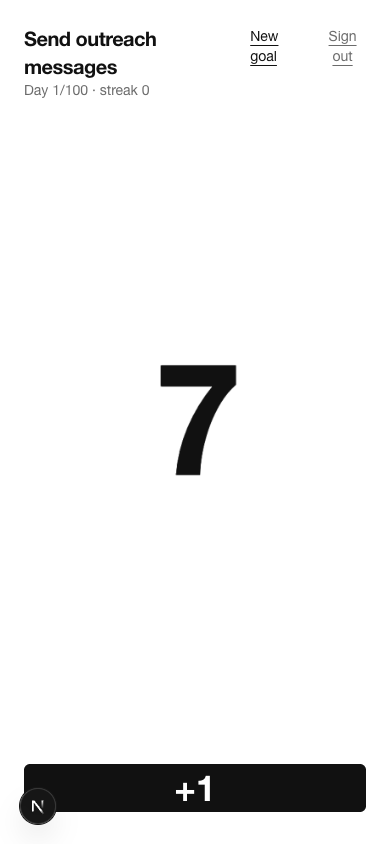
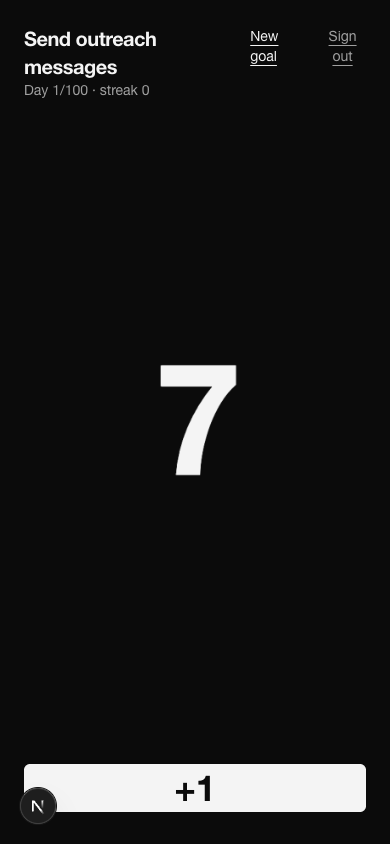
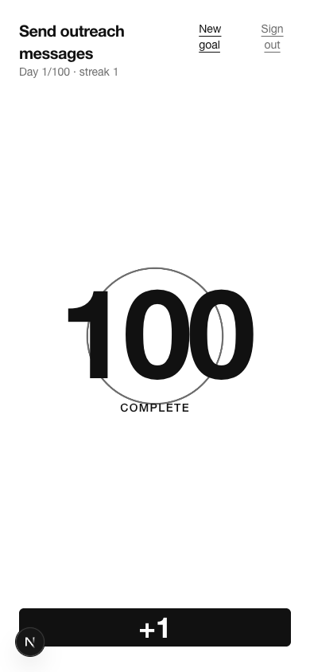
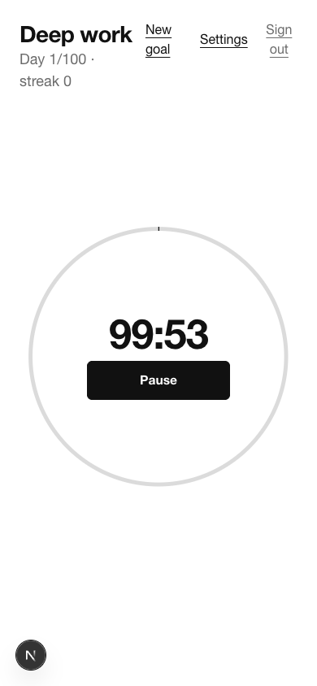
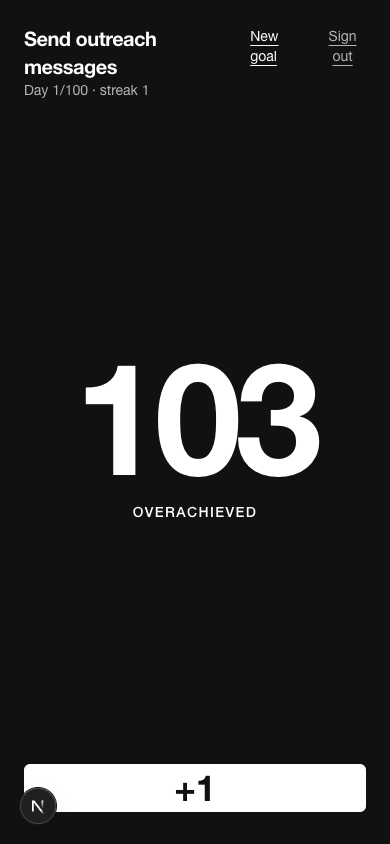
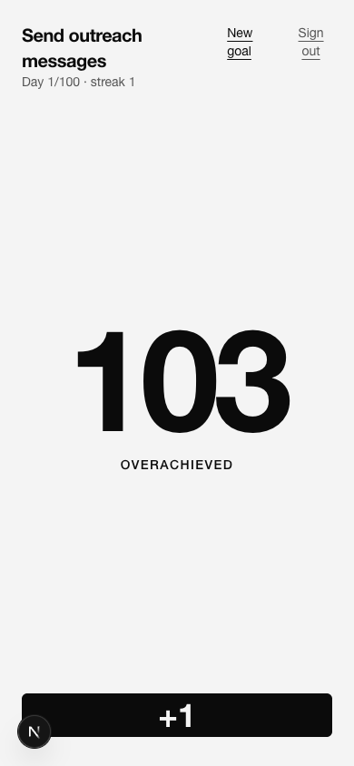
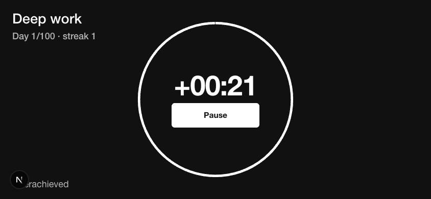
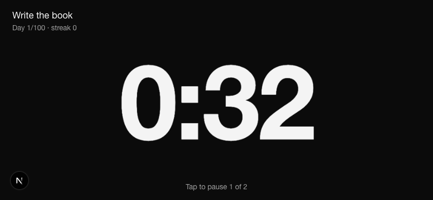

One PR covers T04 to T09. The UI only reads `goal_progress` and calls the T03 RPCs; no progress logic lives in Next.js.

**Done**

- Supabase: `src/lib/supabase/{env,client,server}.ts` (env validated at startup with a clear error) and `src/proxy.ts` (Next 16 proxy: refreshes the session, redirects signed-out users to `/login`).
- T04: `/login` (email magic link), `/auth/callback` (PKCE code exchange), sign-out, onboarding (display name + read-only timezone, then action + count/minutes through `create_challenge`).
- T05: home opens the only goal directly; with 2+ goals it lists them (action, Day X/100, today, streak) with a quiet reminder; "New goal" shows a strong warning plus a required checkbox when a goal already exists.
- T06/T07: daily screen with huge numerals and one big button. Count: optimistic `+1` rolled back on error. Minutes: Start, then Pause/Resume; server errors shown verbatim.
- T08: landscape full-screen goal (running timer, else latest `last_activity_at`), swipe between goals, whole-screen tap target, Wake Lock.
- T09: CSS-only completion animation (off under `prefers-reduced-motion`), inverted colors above 100, strict monochrome following the system theme.
- `supabase/config.toml`: `additional_redirect_urls` fixed from `https://127.0.0.1:3000` to `http://127.0.0.1:3000/**` and `http://localhost:3000/**` (T04 auth-settings item from the #2 review). Email confirmations and password length are not touched: sign-in is passwordless.

**Decisions**

- Google sign-in skipped for now, no button: needs an OAuth client the owner has to create; magic link alone meets the MVP.
- Writes go from the browser client straight to RPCs / the profile insert (RLS + grants guard them), no Server Actions: the rules are in Postgres and a later Expo client would do the same.
- Timer display = `today_value` plus seconds since the client read it. `goal_progress.today_value` is already live as of the read, and counting from the read time avoids phone clock skew versus `timer_started_at`. Re-synced from the view on focus, visibilitychange and after every RPC.
- Count taps are serialized in a queue so `pending` taps and the returned value never double count; the view is re-read when the queue drains.
- Landscape = `(orientation: landscape) and (max-height: 500px)`: phones in landscape, but a wide desktop window keeps the portrait layout.
- Inversion is a `.over` scope that swaps CSS variables, so buttons and borders invert with the page. Exactly 100 is "Complete" (normal colors plus animation), above 100 "Overachieved".
- System font stack and no icon or animation libraries: no new deps beyond `@supabase/ssr` and `@supabase/supabase-js`.
- Proxy matcher excludes all of `/_next` (it broke the dev HMR websocket otherwise).
- Local browser check uses `http://localhost:3000` (Next dev blocks `127.0.0.1` dev resources, which prevented hydration).

**Not verified**

- Wake Lock is feature-detected and wrapped in try/catch; headless Chromium cannot show it acquired. Check on a real phone.
- Sign-up to first tap measured at about 1 s of scripted time; the human target (under 60 s) is not measured.

**Out of scope**: abandon-goal UI, leaderboard, PWA install, Google.

**Screenshots** (390x844 portrait, 844x390 landscape; dev badge visible)

| Portrait light | Portrait dark |
|---|---|
|  |  |
|  |  |
|  |  |

